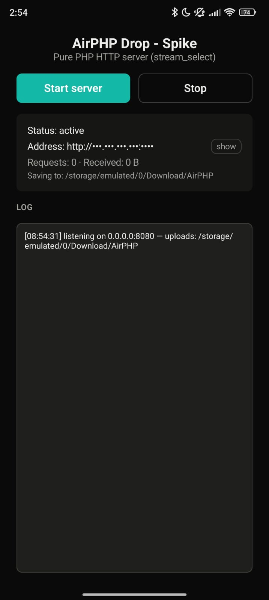
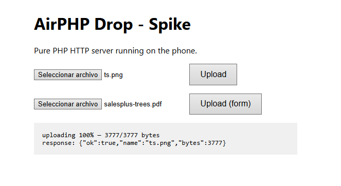
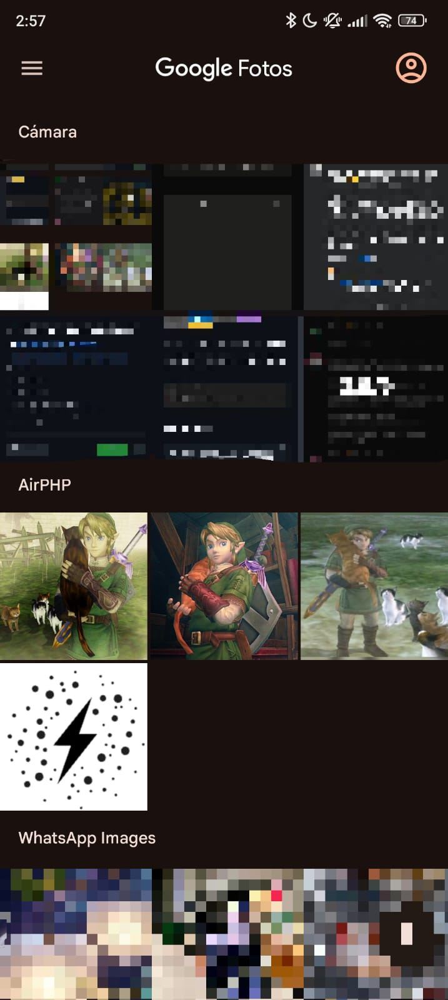

<div align="center">

# AirPHP (🚁📦)

**Your phone is the server.**

AirDrop-style file transfer over your local network, a real HTTP server written in **pure PHP**, running *inside* an Android app. Any device on the same Wi-Fi uploads and downloads files with nothing but a browser.

[](https://github.com/Petox03/AirPHP/actions/workflows/tests.yml)
[](docs/spike-findings.md)
[](https://nativephp.com)
[](docs/docker-build.md)
[](LICENSE)

*No Kotlin. No WebView. No backend.*

</div>

---

| The app serving the LAN | A browser uploading | The file lands in the gallery |
| --- | --- | --- |
|  |  |  |

## What this is

A learning project: an **AirDrop that lives in your pocket**. The Android phone
runs an HTTP server and other devices on the Wi-Fi send/receive files through
their browsers - no app needed on the other side, no cloud, no cables.

Under the hood it's [NativePHP Mobile](https://nativephp.com) v4 (SuperNative):
the UI is native **Jetpack Compose rendered from Blade**, and the PHP 8.4
runtime is embedded in the app itself.

And it started as a spike with one question nobody had documented:
*can the embedded PHP runtime open a socket and serve the LAN?* It can.

## What the spike proved

Measured on a real device (POCO M5, Android 14 / MIUI) - full matrix in
[docs/spike-findings.md](docs/spike-findings.md):

- **`stream_socket_server` + `stream_select` inside an `AsyncTask`** (full
  Laravel boot on a separate PHP interpreter) accepts LAN connections on `:8080`
- **1 GB uploads streamed to disk, MD5-verified**, ~23 MB/s sustained on home
  Wi-Fi, concurrent clients, UI stays responsive
- **Raw PUT *and* `multipart/form-data`**, `curl -F` and plain HTML `<form>`
  uploads both work, `Expect: 100-continue` honored
- Socket survived **~1 min backgrounded with the screen off**
- Received files land in `Download/AirPHP` - **no storage permission** - and get
  indexed into the gallery via MediaStore
- The whole APK is **compiled in Docker - no Android Studio, no SDK** on the
  host ([docs/docker-build.md](docs/docker-build.md))

## How it works

```
Phone (app)                                          Other devices
┌──────────────────────────────────────────┐
│ UI lane (NativeComponent)                │        ┌──────────────────┐
│   start/stop, status, gallery queue ──┐  │        │ browser / curl   │
│                                       │  │        └────────┬─────────┘
│   filesystem IPC (status.json,        │  │                 │ HTTP over Wi-Fi
│   server.stop, gallery.queue)         │  │                 ▼
│                                     ┌─┴── AsyncTask lane ────────────┐
│                                     │  stream_socket_server :8080    │
│                                     │  stream_select event loop      │
│                                     │  → Download/AirPHP (disk)      │
│                                     └────────────────────────────────┘
└──────────────────────────────────────────┘
```

Two PHP interpreters, two lanes. The server loop lives in the AsyncTask lane;
anything needing the native bridge (like MediaStore) is queued back to the UI
lane through plain files - no shared memory, no sockets between them.

## Try it

Two ways:

- **Download the APK** from the latest
  [release](https://github.com/Petox03/AirPHP/releases) and sideload it on an
  Android device (tested on Android 14 / API 34). Releases are signed with a
  stable key, so new versions install over previous ones.
- **Build it yourself** - the whole Android toolchain ships in
  [`docker/android/`](docker/android/), no Android Studio or SDK needed, just
  Docker:

  ```bash
  docker build -t airphp-android docker/android
  docker run --rm \
    -v "$PWD:/src:ro" \
    -v airphp-gradle:/root/.gradle \
    -v airphp-composer:/root/.composer \
    -v airphp-keys:/keys \
    -v "$PWD/native-builds:/out" \
    airphp-android bash /src/docker/android/package.sh
  ```

  Full recipe and gotchas: [docs/docker-build.md](docs/docker-build.md).

## Status

**Phase 0 spike - GO for a pure-PHP server.** What comes next:

- Per-upload **on-device confirmation** (AirDrop-style approve/reject)
- Duplicate-name suffixes, liveness probe with identity (`GET /hello` → `hello`)
- The real product UI from the design reference, as Actions + EDGE components
- CI releases via `nativephp-build-action`-style pipeline on `v*` tags

## Stack

Laravel 13 · PHP 8.4 embedded · NativePHP Mobile 4.8 (SuperNative/EDGE) ·
Pest · SQLite · Docker

## License

[MIT](LICENSE)
